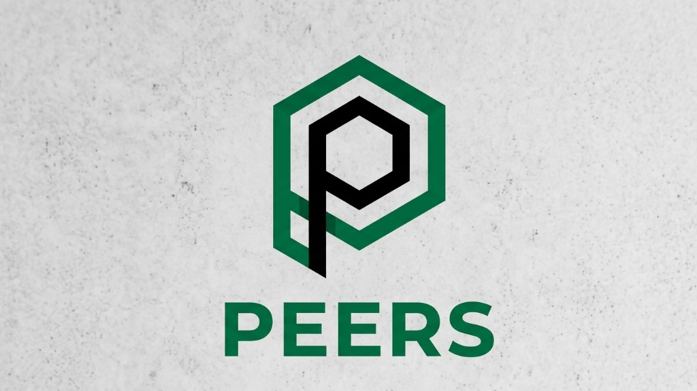

# PEERS - Sistema Integral de Control de Asistencia y Jornadas

<p align="center">
  
</p>

Plataforma operativa para la gestión integral de asistencia, fichadas biométricas, horas extra, guardias y preliquidación de sueldos para operaciones de Oil & Gas en Tierra del Fuego.

## 🚀 Tecnologías

- **Frontend:** Next.js (App Router), React, Tailwind CSS, Lucide Icons
- **Backend & Base de Datos:** Supabase (PostgreSQL, Supabase Auth, Row Level Security)
- **Despliegue:** Vercel (CI/CD automático desde GitHub)

## 👥 Módulos por Rol

- **Operario / Empleado:** Registro de jornada, fichadas biométricas, solicitud de horas extra, corrección de inconsistencias y tickets de RRHH.
- **Supervisor de Turno:** Gestión de personal en yacimiento, aprobación de horas extra y novedades, cronograma de guardias operativas (pasiva/activa/emergencia).
- **Recursos Humanos:** Tablero operativo de ausencias e inconsistencias, validación de horas extra y generación de datasets de preliquidación para payroll (exportable a Excel/CSV).
- **Administrador:** Estado de lectores biométricos, simulación de fichadas en tiempo real, configuración de convenios y audit logs de seguridad.

## 🛠️ Ejecución Local

1. Instalar dependencias:
```bash
npm install
```

2. Configurar variables en `.env.local`:
```env
NEXT_PUBLIC_SUPABASE_URL=https://ripoqygpofkhxzrticvc.supabase.co
NEXT_PUBLIC_SUPABASE_ANON_KEY=tu-anon-key
```

3. Iniciar el servidor:
```bash
npm run dev
```

Abrir [http://localhost:3000](http://localhost:3000) en el navegador.
